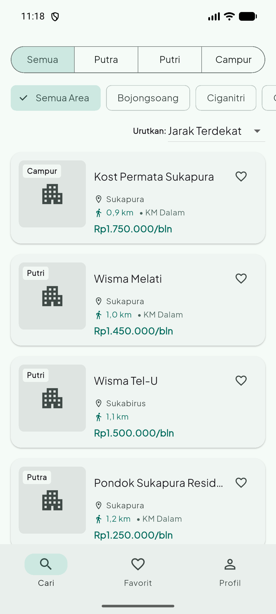
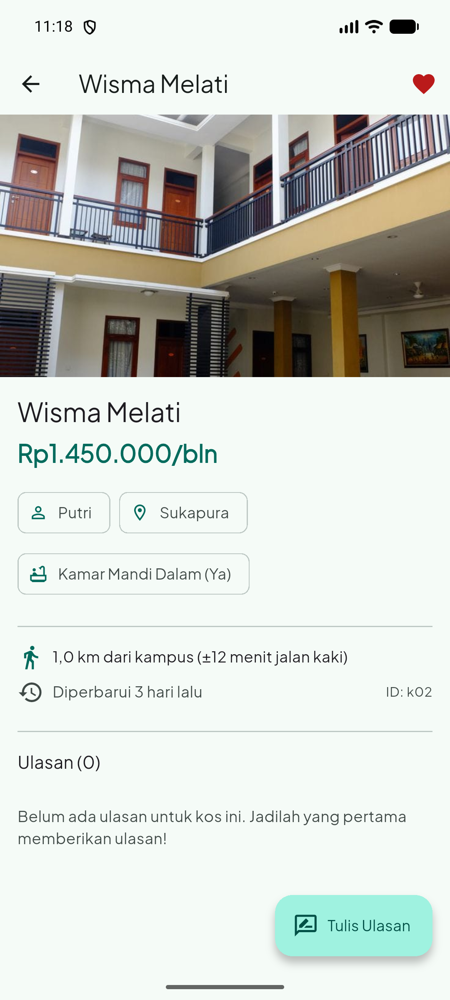
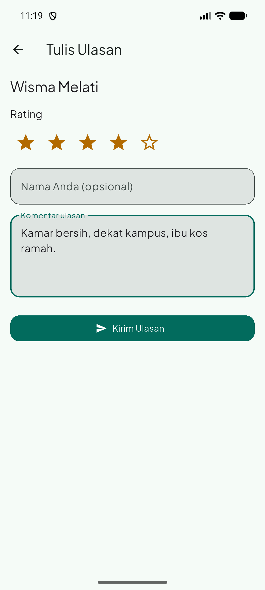
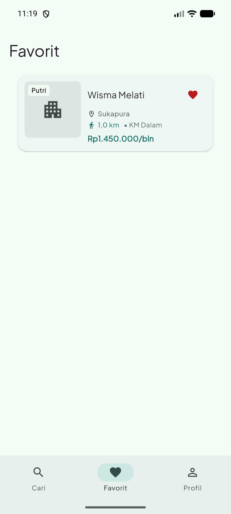
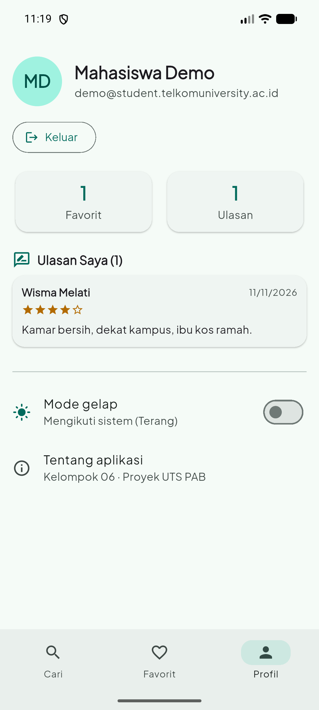
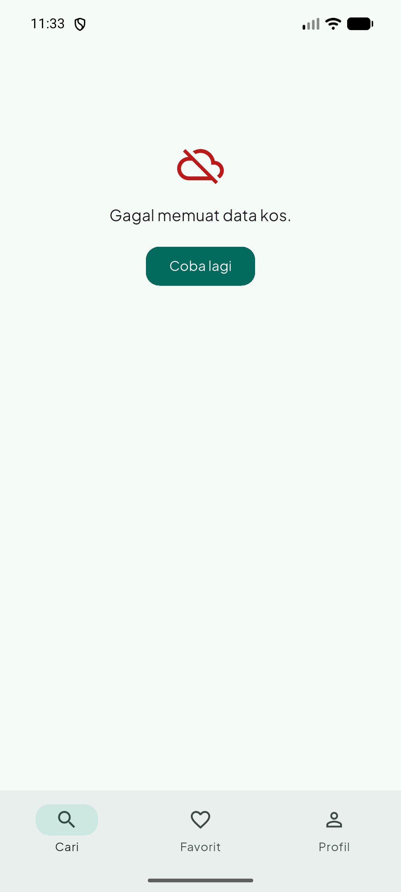
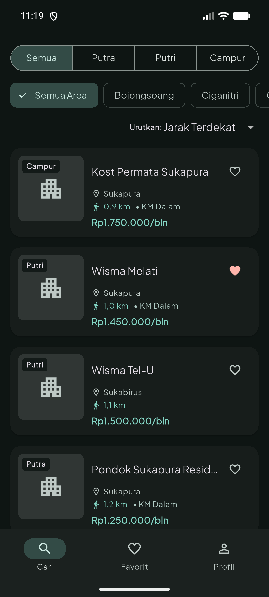

# KosDekat — Info Kos Sekitar Telkom University

Aplikasi Flutter untuk membantu mahasiswa menemukan kos di sekitar Telkom University: Sukapura, Sukabirus, Bojongsoang, Cikoneng, Dayeuhkolot, dan area sekitar.

## Identitas kelompok
- Nama kelompok: **[Isi nama kelompok]**
- Tema: **KosDekat — pencarian kos sekitar Telkom University**
- Anggota:
  | Nama | NIM | Tugas |
  |---|---|---|
  | [Nama anggota 1] | [NIM] | [Tugas] |
  | [Nama anggota 2] | [NIM] | [Tugas] |
  | [Nama anggota 3] | [NIM] | [Tugas] |

## Struktur repository
```text
KosDekat/
├── app/
│   ├── lib/
│   ├── test/
│   ├── assets/
│   └── pubspec.yaml
├── server/
│   ├── bin/server.dart
│   ├── data/kos.json
│   └── pubspec.yaml
├── screenshots/
└── README.md
```

## Persiapan
- Flutter SDK dan Android Studio / Android SDK.
- Dart SDK (mengikuti versi Flutter).
- Perangkat Android atau emulator.
- Aktifkan USB debugging jika menggunakan HP fisik.

## Cara menjalankan server API
Buka terminal pertama dari folder repository:

```bash
cd server
dart pub get
dart run bin/server.dart
```

Server berjalan pada port `8080`. Endpoint:
| Method | Endpoint | Fungsi |
|---|---|---|
| GET | `/kos` | Mengambil seluruh daftar kos (12 data awal) |
| GET | `/kos/<id>` | Mengambil detail kos berdasarkan ID |
| GET | `/area` | Daftar area dan harga rata-rata kos |
| GET | `/health` | Pemeriksaan status server |

Contoh akses endpoint:
- `http://localhost:8080/kos`
- `http://localhost:8080/kos/k01`
- `http://localhost:8080/area`

## Cara menjalankan aplikasi Flutter
Buka terminal kedua:

```bash
cd app
flutter create --platforms=android --org id.ac.telkomuniversity .
flutter pub get
dart run flutter_launcher_icons
flutter run --dart-define=API_URL=http://10.0.2.2:8080
```

`10.0.2.2` adalah alamat khusus emulator Android untuk mengakses `localhost` komputer. Jika memakai HP fisik, ganti alamat tersebut dengan IP lokal komputer yang menjalankan server, misalnya:

```bash
flutter run --dart-define=API_URL=http://192.168.1.10:8080
```

Pastikan HP dan komputer berada pada jaringan Wi-Fi yang sama. Setelah `flutter create`, pastikan file `android/app/src/main/AndroidManifest.xml` memuat permission berikut tepat di bawah tag `<manifest>`:

```xml
<uses-permission android:name="android.permission.INTERNET"/>
```

## Pengujian dan analisis
Jalankan dari folder `app`:

```bash
flutter analyze
flutter test
```

Target pemeriksaan: tidak ada error/warning dari `flutter analyze` dan seluruh test lulus. Jalankan juga pada emulator atau perangkat Android.
---

## 8. Alur Kerja Tim

1. Ambil tiket di Jira, pindahkan ke **In Progress**.
2. Buat branch dari `main`: `feat/SCRUM-<nomor>-<ringkas>`, contoh `feat/SCRUM-15-endpoint-area`.
3. Commit diawali key Jira: `SCRUM-15 tambah endpoint GET /area`.
4. Sebelum PR: `dart format lib test`, `flutter analyze`, `flutter test`.
5. Buka Pull Request, isi template (termasuk baris File:baris untuk tabel README), minta 1 review.
6. Setelah merge, pindahkan tiket ke **Done**.

Detail lengkap ada di [CONTRIBUTING.md](CONTRIBUTING.md).

---

## 9. Tangkapan Layar

| Cari | Detail | Form Ulasan | Favorit |
|------|--------|-------------|---------|
|  |  |  |  |

| Profil | Gagal memuat | Mode gelap |
|--------|--------------|------------|
|  |  |  |

---

## 10. Tabel Pemenuhan Fitur

> Kolom File:baris diisi setelah kode final di-merge. Path relatif terhadap `app/` kecuali diawali `server/`.

### 10.1 Fitur wajib (Bagian 3)

| Poin | File:baris | Keterangan |
|------|-----------|------------|
| P01–P02 Proyek dibuat dengan `flutter create --org id.ac.telkomuniversity`, paket bukan `com.example` | android/app/build.gradle(.kts):_ | applicationId `id.ac.telkomuniversity.kosdekat` |
| P01–P02 Nama aplikasi di launcher sesuai tema (bukan `flutter_application_1`) | android/app/src/main/AndroidManifest.xml:_ | Label "KosDekat" |
| P01–P02 Berjalan di emulator/HP Android, ≥ 4 tangkapan layar dari perangkat | screenshots/ | _n_ tangkapan layar dari _emulator/HP_ |
| P01–P02 `flutter analyze` bersih (tanpa error maupun warning) | - | No issues found! |
| P03 StatelessWidget & StatefulWidget buatan sendiri, setState mengubah tampilan | lib/_:_ | _ |
| P03 TextField + TextEditingController di-dispose | lib/halaman/halaman_form_ulasan.dart:_ | Komentar ulasan |
| P03 ≥ 2 jenis tombol Material 3 | lib/_:_ | FilledButton, IconButton, FloatingActionButton |
| P03 ChoiceChip / FilterChip / SegmentedButton | lib/halaman/tab_cari.dart:_ | SegmentedButton tipe kos |
| P03 SnackBar | lib/_:_ | "Ulasan tersimpan" |
| P04 Model ≥ 6 field (DateTime & bool) | lib/model/kos.dart:_ | 8 field, `diperbarui` DateTime, `kamarMandiDalam` bool |
| P04 Kartu buatan sendiri (Row, Column, Expanded, Stack) | lib/widget/kartu_kos.dart:_ | `KartuKos` |
| P04 ListView.builder | lib/halaman/tab_cari.dart:_ | Daftar kos |
| P04 NavigationBar ≥ 3 tab + IndexedStack | lib/halaman/halaman_utama.dart:73-112 | Cari · Favorit · Profil |
| P05 Halaman detail menerima objek lewat konstruktor | lib/halaman/halaman_detail_kos.dart:_ | `HalamanDetailKos(kos: ...)` |
| P05 Form tambah → `Navigator.pop(context, data)` → `await` → muncul di daftar | lib/halaman/halaman_detail_kos.dart:_ | Ulasan tampil di Detail & Profil |
| P05 Cek `mounted` setelah `await` | lib/halaman/halaman_detail_kos.dart:_ | `if (!mounted) return;` |
| P05 ≥3 widget test | `test/widget_test.dart:10,29` dan `test/halaman_login_test.dart:30,43,54,78,105` | 8 widget test (2 tema, 1 kartu kos, 5 login dan Profil) |
| P06 ColorScheme.fromSeed + darkTheme | lib/tema/tema_kosdekat.dart:_ | Seed `#______` |
| P06 Warna dari `Theme.of(context).colorScheme` (≤ 3 pengecualian) | lib/_:_ | Pengecualian: warna bintang |
| P06 Font kustom | pubspec.yaml:_ | _nama font_ |
| P06 Ikon launcher sendiri (flutter_launcher_icons) | pubspec.yaml:29 | assets/kosdekat_logo.png (512×512), hasil di android/app/src/main/res/mipmap-* |
| P06 Gambar aset lokal di pubspec.yaml | pubspec.yaml:26 | assets/kos_illustration.png tampil di empty state lib/halaman/tab_favorit.dart:32 |
| P07 `server/` shelf + shelf_router, data ≥ 12 item JSON | server/bin/server.dart:_ | server/data/kos.json: _n_ item |
| P07 ≥ 3 endpoint GET | server/bin/server.dart:_ | `GET /kos`, `GET /kos/<id>`, `GET /area` |
| P07 http + dart-define | lib/service/kos_service.dart:8 | API_URL dari `--dart-define` |
| P07 fromJson/toJson + konversi DateTime | lib/model/kos.dart:_ | ISO 8601 |
| P07 FutureBuilder 3 keadaan + tombol Coba lagi | lib/halaman/tab_cari.dart:_ | memuat / gagal / berhasil |
| P07 Test MockClient | test/kos_service_test.dart:32 | Menguji KosService tanpa server |
| P07 Minimal satu test memakai MockClient | test/kos_service_test.dart | Menguji `KosService` tanpa server |

### 10.2 Fitur khas KosDekat (Bagian 5)

| Poin | File:baris | Keterangan |
|------|-----------|------------|
| Model `Kos` sesuai tema | lib/model/kos.dart:_ | id, nama, area, tipe, hargaBulanan, kamarMandiDalam, jarakKm, diperbarui |
| Tab Cari · Favorit · Profil | lib/halaman/halaman_utama.dart:73-112 | NavigationBar 3 tab + IndexedStack |
| Form ulasan: nama kos, rating 1–5 bintang yang bisa diketuk, komentar | lib/halaman/halaman_form_ulasan.dart:_ | Model `Ulasan` terpisah |
| SegmentedButton Putra/Putri/Campur | lib/halaman/tab_cari.dart:_ | |
| Urutan berdasarkan harga atau jarak | lib/halaman/tab_cari.dart:_ | Termurah / Terdekat |
| Harga format Rupiah "Rp1.250.000/bln" | lib/util/format_rupiah.dart:_ | Diuji di test/format_rupiah_test.dart |
| Endpoint khas `GET /area` | server/bin/server.dart:_ | Dipakai di lib/widget/ringkasan_area.dart |

### 10.3 Nilai tambah (Bagian 7)

| Poin | File:baris | Keterangan |
|------|-----------|------------|
| POST ulasan ke server (+5) | _ | _dikerjakan / tidak_ |
| Pull-to-refresh (+2) | _ | _dikerjakan / tidak_ |
| Hero kartu → detail (+3) | _ | _dikerjakan / tidak_ |

---

## 11. Catatan Desain

## Tangkapan layar perangkat
Simpan minimal empat screenshot asli dari emulator/HP ke folder `screenshots/` dengan nama berikut (atau sesuaikan tautan di bawah):
1. `screenshots/01-cari.png` — halaman Cari, daftar kos dan filter.
2. `screenshots/02-detail.png` — halaman detail salah satu kos.
3. `screenshots/03-favorit.png` — halaman Favorit.
4. `screenshots/04-ulasan.png` — form tambah ulasan dengan rating bintang.

Screenshot harus diambil dari aplikasi yang berjalan pada perangkat, bukan mockup desain. Folder ini disiapkan untuk menampung hasil tangkapan layar.

## Tabel pemenuhan fitur

| Poin | File:baris (cek nomor baris aktual dengan editor) | Keterangan |
|---|---|---|
| P01 | `app/pubspec.yaml`; `app/android/app/src/main/AndroidManifest.xml` (dibuat oleh `flutter create`) | Identitas aplikasi KosDekat; package org `id.ac.telkomuniversity`; label launcher KosDekat. Jalankan pada emulator/HP dan lampirkan screenshot. |
| P02 | `app/assets/kosdekat_logo.png`; `README.md` | Ikon aplikasi disiapkan melalui `flutter_launcher_icons`; screenshot perangkat disimpan di `screenshots/`. |
| P03 | `app/lib/screens/home_page.dart`; `app/lib/screens/add_review_page.dart` | StatefulWidget, TextField + controller, SegmentedButton, FilledButton, IconButton, SnackBar, rating bintang interaktif; StatelessWidget ada pada kartu/detail/profil. |
| P04 | `app/lib/models/kos.dart`; `app/lib/widgets/kos_card.dart`; `app/lib/screens/home_page.dart` | Model memiliki 8 field termasuk bool dan DateTime; kartu memakai Row, Column, Expanded; daftar ListView.builder; NavigationBar 3 tab dan IndexedStack. |
| P05 | `app/lib/screens/kos_detail_page.dart`; `app/lib/screens/add_review_page.dart`; `app/lib/screens/home_page.dart`; `app/test/` | Detail menerima model lewat konstruktor; form mengembalikan Map lewat Navigator.pop; hasil diterima setelah await dan dicek mounted; minimal 3 widget test dan 1 test MockClient tersedia. |
| P06 | `app/lib/tema/tema_kosdekat.dart:5`; `app/lib/main.dart:22` | P06 ColorScheme.fromSeed + darkTheme \| lib/tema/tema_kosdekat.dart:5 \| Seed #14695C (referensi Papa Kost). ThemeData dengan ColorScheme.fromSeed (terang & gelap), font Google Fonts Plus Jakarta Sans, cardTheme, filledButtonTheme, navigationBarTheme, switch mode gelap di profil. |
| P07 | `server/bin/server.dart`; `server/data/kos.json`; `app/lib/services/api_service.dart`; `app/lib/models/kos.dart`; `app/lib/screens/home_page.dart`; `app/test/api_service_test.dart` | Shelf API dengan GET `/kos`, `/kos/<id>`, `/area`; 12 data JSON; API_URL via dart-define; fromJson/toJson; FutureBuilder tiga keadaan dan tombol Coba lagi; MockClient test. |

## Catatan implementasi
- Form ulasan menyimpan ulasan ke state aplikasi (sementara/in-memory), belum ke server/database.
- Endpoint `/area` menghitung jumlah kos dan rata-rata harga bulanan per area dari file JSON.
- Data kos adalah data contoh untuk keperluan demonstrasi. Verifikasi alamat, harga, fasilitas, dan ketersediaan langsung kepada pemilik kos sebelum digunakan sebagai informasi aktual.
- Baris pada tabel pemenuhan fitur perlu diverifikasi kembali menggunakan editor setelah file dibuka, karena nomor baris dapat berubah jika kode diedit.
